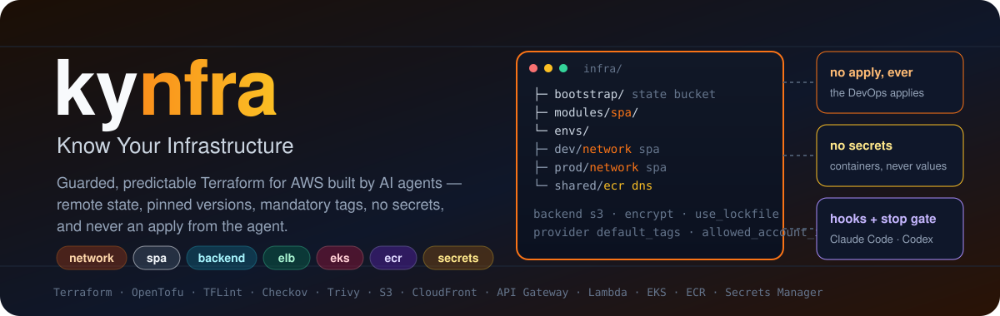
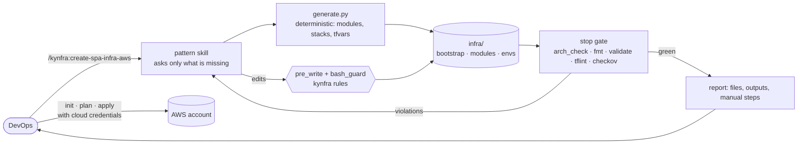
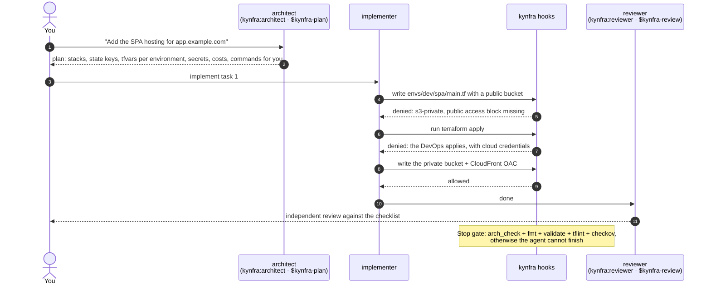

<p align="center">
  
</p>

<p align="center">
  <a href="https://github.com/en1-gma/kynfra/actions/workflows/kit-tests.yml"></a>
  
  
  
  
  
  
</p>

# kynfra — Know Your Infrastructure

**kynfra is a Claude Code and Codex plugin that makes AI-generated cloud infrastructure safe and predictable.** You describe what you want to host; kynfra produces the complete Terraform for it (remote state, pinned versions, mandatory tags, encryption, least privilege already applied), validates it locally, and stops there: **the DevOps applies it**. Every rule that can be checked automatically is enforced by a hook or a CI step, not left to a prompt.

> It is the infrastructure sibling of [**kybes — Know Your Backend**](https://github.com/ivandilelio/kybes) and [**kyfes — Know Your Frontend**](https://github.com/en1-gma/kyfes): same philosophy, same architecture of hooks, stop gate and CI. Inside a kybes repository, `/kynfra:create-backend-infra-aws` reads the project and writes the infrastructure of every function, microservice and job.

---

## Why

Ask an agent for "the infrastructure for a SPA" ten times and you get ten architectures: a public bucket, a local state file, an access key in the provider block, a security group open to the world on port 22, a `terraform apply` run from the chat against a real account. kynfra takes that variance (and that risk) away:

| Problem | What kynfra does |
|---|---|
| Different layout and conventions at every run | A fixed layout (`bootstrap/`, `modules/<pattern>/`, `envs/<env>/<stack>/`), one stack and one state per pattern and environment, differences between environments only in `tfvars` |
| Local state, unpinned providers, no tags | **Remote S3 state** with encryption and native lock, `~>` version pinning, committed lock file, `default_tags` and `allowed_account_ids` on every provider; writes that break this are **rejected** |
| Secrets in files, variables and state | Secrets are **containers** (`aws_secretsmanager_secret`); the value is entered outside Terraform. Plaintext secrets, static credentials and `sensitive`-less variables are rejected |
| Insecure defaults (public buckets, HTTP, `0.0.0.0/0`, `Action: *`) | Per-family AWS rules: S3, CloudFront, load balancers, security groups, IAM, KMS, log retention, EKS, ECR, API Gateway, Lambda |
| The agent touching a real account | `terraform apply/destroy/import/plan`, mutating `aws`/`kubectl`/`helm`/`az`/`gcloud` and tool downloads outside `tools.py` are **refused** by the shell guard; the decisive barrier is that the agent session has no cloud credentials |
| Warnings silenced with comments | `checkov:skip`, `trivy:ignore`, `tflint-ignore` are rejected. Exceptions live only in `.kynfra/config.json`, with an expiry date, and only the user can write that file |
| "It validates on my machine" | A **stop gate** blocks completion until `arch_check`, `fmt`, `init -backend=false` + `validate`, TFLint and Checkov (or Trivy) pass; CI runs the same checks in strict mode |

## How it works



### Life of a change with Claude Code or Codex



## Commands

One command per pattern and platform (AWS in v1). Each one reads `.kynfra/config.json` and what already exists, asks **once** for what is missing, runs the deterministic generator and the checks, then reports the files, the outputs, the commands you must run and what stays manual.

| Command (skill) | What it generates |
|---|---|
| `/kynfra:create-network-infra-aws` | VPC on 2-3 AZs with public, private and isolated subnets, NAT (one per AZ in prod), VPC endpoints, encrypted flow logs, empty default security group |
| `/kynfra:create-spa-infra-aws` | Private S3 + CloudFront with OAC, ACM certificate, Route53 alias, HTTPS and TLS 1.2+, client-side routing via CloudFront Function, security headers, access logs, WAF (mandatory in prod), optional `/api/*` to the backend |
| `/kynfra:create-backend-infra-aws` | The **complete backend of a kybes project**: API Gateway REST from `schemas/openapi.yaml`, one Lambda per function, VPC link to the EKS microservices, SQS + DLQ + schedule + Pod Identity per job, RDS Proxy with IAM auth. `api-coverage` keeps schema and infrastructure aligned |
| `/kynfra:create-elb-infra-aws` | ALB (or NLB) with TLS 1.3 policy, ACM certificate, 80 to 443 redirect, access logs, WAF and deletion protection in prod, IP target group |
| `/kynfra:create-eks-infra-aws` | EKS with private endpoint, KMS-encrypted Secrets, control plane logs, access entries, IMDSv2 nodes, managed add-ons, Pod Identity roles, Karpenter resources, plus a `kubernetes-addons` stack (AWS Load Balancer Controller, Karpenter, KEDA at pinned versions) |
| `/kynfra:create-ecr-infra-aws` | Shared private registry: immutable tags, scan on push, KMS, lifecycle policy, pull-only repository policy |
| `/kynfra:create-secrets-infra-aws` | Secrets Manager vault with a dedicated KMS key, value-less secrets, per-role resource policy, recovery window, optional rotation and replica |
| `kynfra-init` | Guided installation: detects the context, asks only what is missing, runs the installer |
| `kynfra-plan` / agent `kynfra:architect` | A compliant plan (stacks, state keys, environments, secrets, costs, commands for the DevOps), no files written |
| agent `kynfra:implementer` | Implements one task of an approved plan under the rules |
| `kynfra-review` / agent `kynfra:reviewer` | Independent review: APPROVATO / DA CORREGGERE |
| `kynfra-tools` (`/kynfra:tools`) | Check and install Terraform, TFLint, its AWS ruleset and Checkov, **one tool at a time, with your explicit approval for that tool**, recorded in `.kynfra/tools.lock.json` |
| `kynfra-architecture` | The binding rules, loaded before every plan or change |

The bootstrap stack (the S3 bucket that holds the remote state) is generated by `generate.py --pattern bootstrap` and is offered by the commands when it is missing. Each pattern has its own page in [`docs/pattern/`](docs/README.md#pattern-aws).

## One layout, every pattern

```text
infra/                              ← infra_root: "infra" inside a kybes/kyfes repository, "." in an infrastructure-only one
├── bootstrap/                      ← remote state bucket (the only root module with a local backend)
├── modules/
│   └── spa/                        ← reusable module: main.tf, variables.tf, outputs.tf, versions.tf, README.md
└── envs/
    ├── dev/{network,spa,…}/        ← one root module and one state per pattern and environment
    ├── prod/{network,spa,…}/       ← backend.tf, providers.tf, versions.tf, main.tf, variables.tf, terraform.tfvars, outputs.tf, .terraform.lock.hcl
    └── shared/{dns,ecr,apigw-account}/   ← resources shared by all environments
```

Stacks read each other with `terraform_remote_state` on the same backend (state key `<project>/<env>/<stack>.tfstate`). Names are always prefixed `<project>-<env>`, account IDs and regions come from variables, never from the modules. `prod` is stricter by default (deletion protection, NAT per AZ, WAF, longer log retention); the difference between environments lives only in `terraform.tfvars`.

## Guardrails

| When | Check | Default |
|---|---|---|
| before every write | file layout under `infra_root`, kebab-case names, environments declared in config | block |
| before every write | remote state without encryption or lock, local backend outside `bootstrap/`; unpinned `required_version`/providers/modules | block |
| before every write | static credentials, plaintext secrets, `secret_string` literals, sensitive variables without `sensitive = true` or with a default | block |
| before every write | AWS provider without the mandatory `default_tags` or without `allowed_account_ids` | block |
| before every write | `local-exec`/`remote-exec`/`file`/external provisioners, inline scanner suppressions (`checkov:skip`, `trivy:ignore`, `tflint-ignore`) | block |
| before every write | S3 not private, CloudFront/ALB without HTTPS, security groups open to the world, IAM wildcards, KMS without rotation, logs without retention, EKS/ECR/API Gateway/Lambda hardening, prod toggles (WAF, deletion protection, KMS on logs) | block |
| before every write | the agent's own guardrails: `.kynfra/`, `tools/kynfra/`, agent settings and hooks, kynfra rules, skills and CI workflow, `.terraform.lock.hcl` | block |
| before every shell command | `terraform`/`tofu` `apply`, `destroy`, `import`, `plan`, `taint`, `state`, `force-unlock`, `init` with a real backend; mutating `aws`, `kubectl`, `helm`, `az`, `gcloud`, `vercel`; downloads and installs outside `tools.py`; writes through the shell into IaC files or protected files | block |
| after every write | unreadable HCL is a blocking finding (fail closed); `variables-typed`, `region-pinning`, `literal-reuse` warnings | warn |
| before finishing (main agent and every subagent) | `arch_check` + `terraform fmt -check` + `init -backend=false` and `validate` per stack + TFLint + Checkov/Trivy + your own `stop_gate.commands` | block |
| in a kybes repository | `api-coverage`: every OpenAPI operation has a handler, every function, microservice and job has its infrastructure | block |
| in CI | the same checks with `--strict`: a missing tool is an error | fail build |

Every rule can be set to `block`, `warn` or `off` in `.kynfra/config.json`, a file the agent is not allowed to modify. Exceptions are entries `{rule, path, resource, reason, expires}` in that same file: after `expires` the rule blocks again. The same Python hooks (standard library only, Python 3.10+) run in **Claude Code** and **Codex**. Write hooks evaluate the file as it will be after the change and only block what the change introduces; the stop gate and CI check everything. Without `.kynfra/config.json` every hook is a no-op.

The shell guard is **heuristic**: it parses the command like a shell would and refuses what it cannot determine, but it cannot be a proof. The decisive barrier against an `apply` from the agent is that the session has **no cloud credentials**; the stop gate and CI are the barriers behind it.

## Install

### Claude Code

```text
/plugin marketplace add en1-gma/kynfra
/plugin install kynfra@kynfra
```

Then, inside a project: *"set up kynfra in this project"*. The `kynfra-init` skill detects the context and runs the installer.

### Codex

```bash
codex plugin marketplace add en1-gma/kynfra
codex plugin add kynfra@kynfra
```

Then: *"Use $kynfra-init to set up kynfra in this project"*. The installer also writes the project-level Codex files (`AGENTS.md` block, `.agents/skills/kynfra-*` and `create-*-infra-*`, `.codex/agents/kynfra_*.toml`, `.codex/hooks.json`), so teammates get the rules without installing anything. Codex asks you to trust the project and review the hooks the first time.

### Command line

```bash
git clone https://github.com/en1-gma/kynfra
kynfra/install.sh --target /path/to/project --project acme --envs dev,staging,prod --region eu-south-1 --account-id 123456789012
```

| Option | Values |
|---|---|
| `--iac` | `terraform` (default), `opentofu` |
| `--infra-root` | folder of the infrastructure (auto: `infra` if `.kybes/`, `.kyfes/` or `infra/` exists, otherwise `.`) |
| `--project`, `--envs`, `--region`, `--account-id` | project name (kebab-case), environments (default `dev,staging,prod`), region (default `eu-south-1`), AWS account |
| `--agents` | `claude`, `codex`, `both` (default) |
| `--ci github\|none`, `--scope local\|project\|user`, `--no-plugin`, `--force`, `--uninstall` | |

The installer is idempotent. It creates `.kynfra/config.json`, a versioned copy of the kit in `tools/kynfra/` (used by CI, Codex hooks and teammates), `.tflint.hcl`, `.claude/rules/kynfra/`, the `permissions.deny` rules in `.claude/settings.json`, the managed blocks in `CLAUDE.md` / `AGENTS.md` and `.github/workflows/kynfra-check.yml`. It writes no IaC, runs no Terraform and downloads no tool: tools are installed one at a time with `/kynfra:tools`. `--force` and `--uninstall` are refused to the agent.

### What you get in each agent

| | Claude Code | Codex |
|---|---|---|
| Rules | skill `kynfra-architecture` + path-scoped rules + `CLAUDE.md` block | skill `$kynfra-architecture` + `AGENTS.md` block |
| Plan | agent `kynfra:architect` | skill `$kynfra-plan`, agent `kynfra_architect` |
| Implement | agent `kynfra:implementer` | agent `kynfra_implementer` |
| Review | agent `kynfra:reviewer` | skill `$kynfra-review`, agent `kynfra_reviewer` |
| Hooks | `PreToolUse` (writes and `Bash`), `PostToolUse`, `Stop`, `SubagentStop`, `SessionStart` | `PreToolUse` (`apply_patch` and shell), `PostToolUse`, `Stop`, `SessionStart` |
| Permissions | `permissions.deny` in `.claude/settings.json`: no `Edit` of `.kynfra/**`, `tools/kynfra/**`, `.claude/settings*.json` | none: protected files are defended by the hooks and CI |

## The family

| | Scope | Repository |
|---|---|---|
| **kybes** | backend: API Gateway, Lambda, microservices, jobs | [ivandilelio/kybes](https://github.com/ivandilelio/kybes) |
| **kyfes** | frontend: one layout, cookie sessions, RBAC, TanStack Query | [en1-gma/kyfes](https://github.com/en1-gma/kyfes) |
| **kynfra** | infrastructure: Terraform on AWS, then Azure and Vercel | this repository |

The three share the same idea (rules the agent cannot talk its way around) and the same layout of plugin, hooks and docs. kynfra reads the kybes contract (`schemas/openapi.yaml`, `services/`, `jobs/`, `schemas/db`) and the kyfes SPA is hosted by `/kynfra:create-spa-infra-aws`.

## Status

**Preview.** Terraform (OpenTofu with the same files) on AWS, seven patterns plus the state bootstrap, a single AWS account for all environments. Next: pipelines with OIDC, the account manager for multi-account setups, Azure, Vercel. See the [roadmap](docs/roadmap.md).

## How kynfra itself is verified

| | Verification |
|---|---|
| Hooks and rules | `tests/hooks/`: the HCL parser, every rule with compliant and non-compliant cases, `pre_write` on the resulting file, `bash_guard` (allowed and refused commands), stop gate, exceptions, kybes reader, generator, tool manager, installer for Claude Code and Codex, and the consistency of these docs with the product |
| Patterns | `tests/patterns/`: every pattern of `patterns.json` is generated in an empty folder with several environments and must pass `arch_check --strict` with zero findings; then `terraform fmt -check`, `init -backend=false`, `validate`, TFLint and Checkov |
| CI | `.github/workflows/kit-tests.yml`: the `hooks` job (Python 3.10 and 3.12) and one `patterns` job per pattern, with the tools installed by `tools.py` at the pinned versions, no cloud credentials |

## Documentation

Detailed documentation (Italian) is in [`docs/`](docs/README.md): [architecture](docs/architettura.md) · [configuration](docs/configurazione.md) · [guardrails](docs/controlli.md) · [tools](docs/strumenti.md) · [secrets](docs/segreti.md) · [accounts](docs/account.md) · [Codex](docs/codex.md) · [developing the kit](docs/sviluppo.md) · [roadmap](docs/roadmap.md) · patterns: [network](docs/pattern/network.md), [spa](docs/pattern/spa.md), [backend](docs/pattern/backend.md), [elb](docs/pattern/elb.md), [eks](docs/pattern/eks.md), [ecr](docs/pattern/ecr.md), [secrets](docs/pattern/secrets.md).

## A note on security

kynfra generates and validates infrastructure code; it does not make an account secure by itself. The generated modules follow the rules above, but IAM boundaries, SCPs, CloudTrail, account hygiene and the review of every `terraform plan` before an `apply` remain yours. The checks on shell commands are heuristic: keep cloud credentials out of the agent session, and treat the stop gate and the CI run as the barriers behind the hooks. The scanner baseline shipped with the kit lists, with a reason each, the few Checkov checks that the generated modules deliberately do not satisfy.

## License

[MIT](LICENSE)
