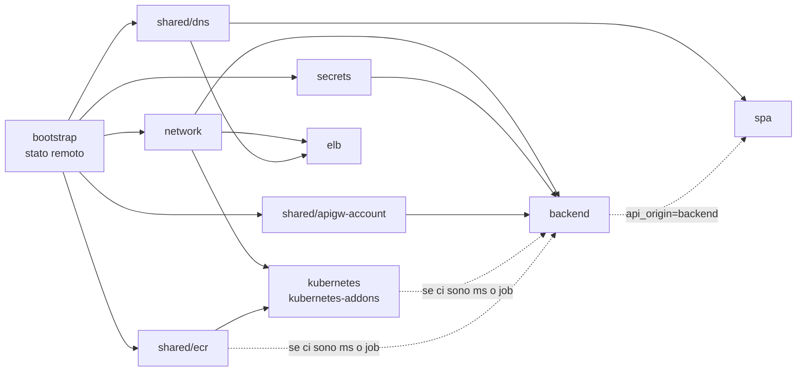

# Documentazione di kynfra

kynfra (Know Your Infrastructure) è un plugin per Claude Code e Codex che rende sicura e prevedibile l'infrastruttura Terraform scritta con agenti AI. Genera ambienti completi su AWS con le best practice già applicate, li valida in locale e si ferma lì: **`plan` e `apply` li esegue il DevOps**, con le sue credenziali. Le regole vincolanti sono nella skill [`kynfra-architecture`](../plugins/kynfra/skills/kynfra-architecture/SKILL.md); questa cartella le spiega e motiva. La specifica di progetto è in [`superpowers/specs/`](superpowers/specs/2026-10-20-kynfra-design.md).

| Documento | Contenuto |
|---|---|
| [architettura.md](architettura.md) | struttura del plugin, layout dell'infrastruttura generata, principi (stato remoto, versioni, tag, ambienti), flusso di un comando |
| [configurazione.md](configurazione.md) | `.kynfra/config.json`: ogni chiave, eccezioni con scadenza, baseline dello scanner |
| [controlli.md](controlli.md) | hook (scritture e comandi shell), stop gate, CI: ogni regola, cosa rifiuta e come correggerla |
| [strumenti.md](strumenti.md) | `tools.py`: download approvato strumento per strumento, checksum, registro, isolamento di pip |
| [segreti.md](segreti.md) | come kynfra tratta i segreti: contenitori, valori fuori da Terraform, argomenti write-only |
| [account.md](account.md) | account AWS unico oggi, struttura pronta per più account, gestore degli account |
| [codex.md](codex.md) | come kynfra funziona in Codex |
| [sviluppo.md](sviluppo.md) | come contribuire al kit e verificarlo, harness dei pattern con gli strumenti reali |
| [roadmap.md](roadmap.md) | cosa arriverà e cosa è rimasto fuori dalla v1 |

## Pattern AWS

Ogni pattern ha un comando `/kynfra:create-<pattern>-infra-aws`, un modulo in `templates/aws/modules/<pattern>/`, uno stack per ambiente, regole dedicate e un test in CI. Il pattern `bootstrap` (bucket dello stato remoto) non ha un comando: lo genera `generate.py --pattern bootstrap` e lo propongono gli altri comandi quando manca (vedi [architettura](architettura.md#bootstrap-dello-stato-remoto)).

| Pattern | Comando | Documento |
|---|---|---|
| rete | `/kynfra:create-network-infra-aws` | [pattern/network.md](pattern/network.md) |
| frontend SPA | `/kynfra:create-spa-infra-aws` | [pattern/spa.md](pattern/spa.md) |
| backend kybes | `/kynfra:create-backend-infra-aws` | [pattern/backend.md](pattern/backend.md) |
| load balancer | `/kynfra:create-elb-infra-aws` | [pattern/elb.md](pattern/elb.md) |
| Kubernetes (EKS) | `/kynfra:create-eks-infra-aws` | [pattern/eks.md](pattern/eks.md) |
| registry di container | `/kynfra:create-ecr-infra-aws` | [pattern/ecr.md](pattern/ecr.md) |
| segreti | `/kynfra:create-secrets-infra-aws` | [pattern/secrets.md](pattern/secrets.md) |

Ordine tipico di applicazione per un ambiente completo: `bootstrap` (una volta per account), `network`, `secrets`, `ecr` (condiviso), `kubernetes` e `kubernetes-addons`, `backend` (con prima `apigw-account`, una volta per account e regione), `elb`, `spa` (con prima `dns` se la zona la crea kynfra).

