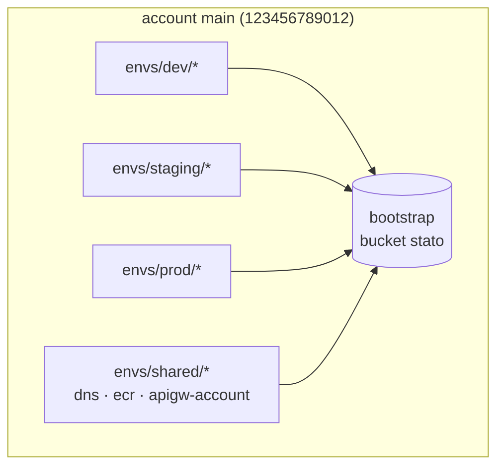

# Account AWS

## Oggi: un account unico

Nella v1 tutti gli ambienti (`dev`, `staging`, `prod`) vivono in **un solo account AWS**. La config però descrive gli account in modo esplicito, così il passaggio a più account non cambia la struttura del codice:

```json
"accounts": { "main": { "id": "123456789012" } },
"environments": { "dev": { "account": "main" }, "staging": { "account": "main" }, "prod": { "account": "main" } }
```

- Ogni stack riceve `account_id` dai `tfvars` dell'ambiente e lo usa in `allowed_account_ids` (`account-guard`): un `apply` con le credenziali dell'account sbagliato fallisce subito.
- C'è un solo `bootstrap/` (bucket dello stato) per account.
- Le risorse condivise tra ambienti (zona DNS, registry ECR, il ruolo CloudWatch di API Gateway) stanno in stack `envs/shared/`.
- Poiché nello stesso account convivono tutti gli ambienti, i nomi sono sempre prefissati `<progetto>-<env>`.
- Il codice della v1 non dà per scontato l'account unico: nessun ID scritto nei moduli (`region-pinning`), `account_id` sempre passato come variabile.



Due singleton per account (e regione) da ricordare quando più progetti condividono l'account: il ruolo CloudWatch di API Gateway (`envs/shared/apigw-account`, impostazione unica dell'account: se un altro progetto l'ha già applicato si salta il passo) e la quota di 10 resource policy di CloudWatch Logs per regione, condivisa dagli stack che loggano WAF o query DNS.

## Domani: il gestore degli account

Previsto come fase successiva (vedi [roadmap](roadmap.md)): il comando **`/kynfra:manage-accounts-aws`** per passare a più account (per esempio un account per `prod` e uno per `dev`/`staging`). Dovrà:

1. aggiungere account alla config (`accounts`) e assegnarli agli ambienti (`environments.<env>.account`);
2. generare un `bootstrap/` per account;
3. configurare i provider con `assume_role` verso un ruolo per account;
4. rendere cross-account le dipendenze: pull ECR, delega DNS, lettura dello stato.

Non esiste ancora e non va simulato a mano modificando `accounts`: la config è protetta e i pattern v1 assumono che tutti gli ambienti condividano l'account del bootstrap.
