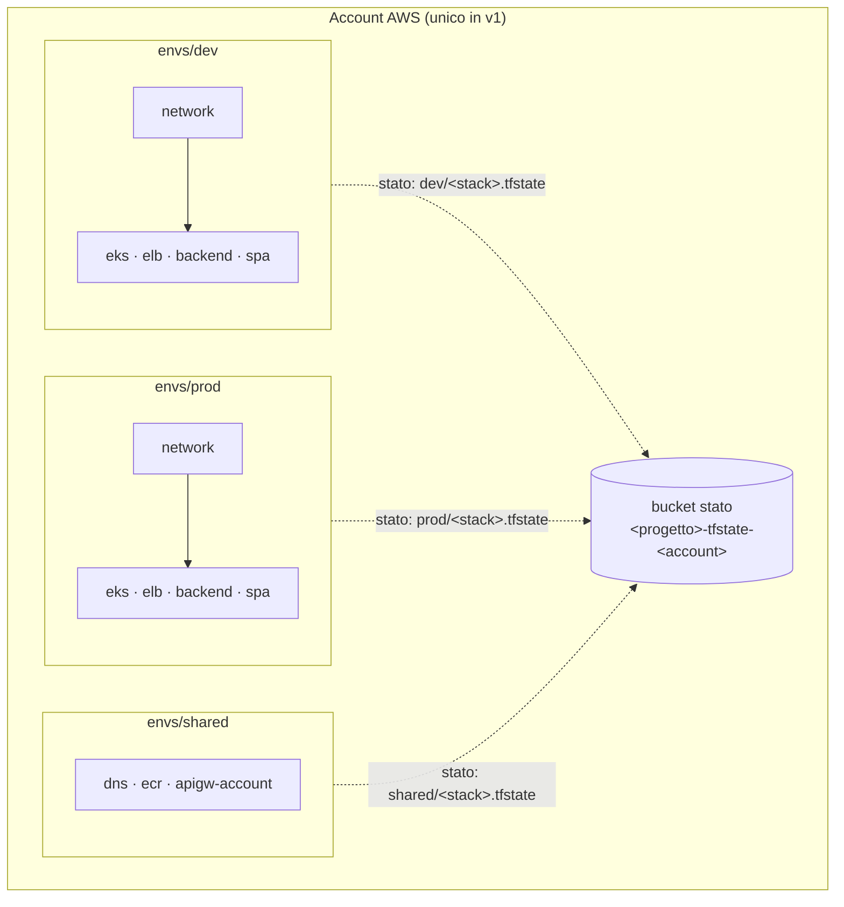
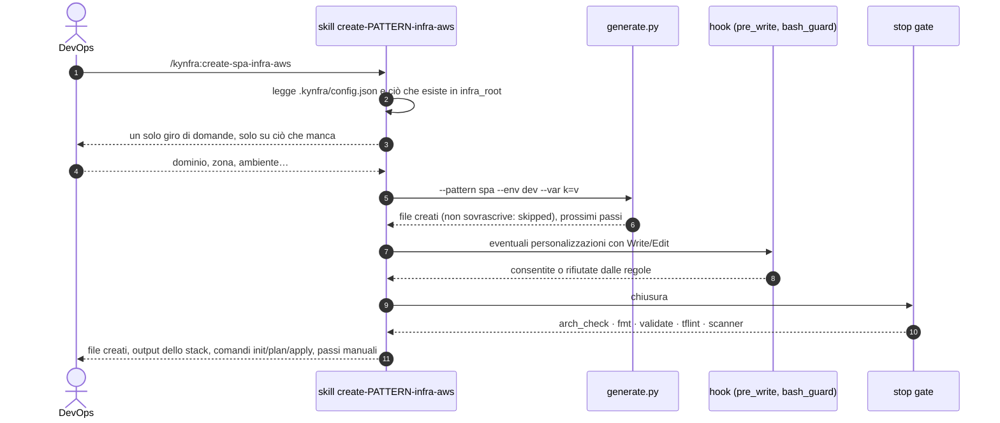

# Architettura

## Il plugin

```text
kynfra/
├── .claude-plugin/marketplace.json          marketplace Claude Code
├── .agents/plugins/marketplace.json         marketplace Codex
├── install.sh                               wrapper → plugins/kynfra/install.sh
├── README.md                                in inglese, con banner
├── docs/                                    questa documentazione (in italiano)
├── tests/{run.sh,hooks/,patterns/}          test del kit
├── .github/workflows/kit-tests.yml          CI del kit
└── plugins/kynfra/
    ├── .claude-plugin/plugin.json  .codex-plugin/plugin.json
    ├── install.sh                           installer idempotente
    ├── hooks/hooks.json                     SessionStart, PreToolUse (scritture + shell), PostToolUse, Stop, SubagentStop
    ├── agents/{architect,implementer,reviewer}.md
    ├── scripts/                             solo libreria standard Python 3 (3.10+)
    ├── skills/                              kynfra-architecture, -init, -plan, -review, -tools e create-<pattern>-infra-aws
    └── templates/                           config, blocco AGENTS/CLAUDE, regole per percorso, CI, agenti e hook Codex,
                                             versions.json, tools-catalog.json, scanner-baseline.json, aws/
```

| Script | Ruolo |
|---|---|
| `hcl.py` | tokenizer/parser HCL minimale: blocchi, attributi, liste, oggetti (le espressioni restano testo), numeri di riga; errori di sintassi riportati, mai ignorati |
| `rules.py`, `rules_common.py`, `rules_aws.py` | motore delle regole: configurazione, layout, file protetti, eccezioni; regole trasversali; regole AWS (una per famiglia di risorse) |
| `kybes.py` | lettore dei progetti kybes e regola `api-coverage` |
| `pre_write.py`, `post_edit.py`, `bash_guard.py`, `session_start.py`, `stop_gate.py`, `hook_common.py` | gli hook (vedi [controlli](controlli.md)) |
| `shell_lex.py`, `shell_recipes.py` | lexer della shell e lettori di ricette `make`/`just`/`task` usati da `bash_guard` |
| `arch_check.py` | controllo completo del progetto, usato da stop gate e CI |
| `external.py` | strumenti esterni: `fmt`, `init`/`validate` per stack, TFLint, Checkov/Trivy |
| `tools.py` | download approvato degli strumenti (vedi [strumenti](strumenti.md)) |
| `generate.py` | generatore deterministico dei pattern |

Come negli altri membri della famiglia (kybes, kyfes), senza `.kynfra/config.json` ogni hook è un no-op, il progetto si individua dal file scritto (la config più vicina, quindi anche nei monorepo) e il kit versionato è copiato in `tools/kynfra/` per CI, colleghi e hook di Codex.

## Contesto d'uso: repository applicativo o di sola infrastruttura

L'installer rileva `.kybes/`, `.kyfes/` o una cartella `infra/` già presente: in quel caso `infra_root = "infra"`, altrimenti `infra_root = "."`. Il valore resta modificabile in config. Le regole di kynfra si applicano solo ai file sotto `infra_root`, così convivono con quelle di kybes e kyfes nello stesso repository senza sovrapporsi. In un repository kybes l'installer scrive anche `kybes: {"root": ".", "openapi": "schemas/openapi.yaml"}`, che abilita il pattern `backend` e la regola `api-coverage`.

## Layout dell'infrastruttura generata

```text
<infra_root>/
├── bootstrap/                  stato remoto: bucket S3 (versioning, SSE-KMS, public access block, solo TLS)
├── modules/<pattern>/          modulo riutilizzabile: main.tf, variables.tf, outputs.tf, versions.tf, README.md
├── envs/<env>/<stack>/         root module: backend.tf, providers.tf, versions.tf, main.tf, variables.tf,
│                               terraform.tfvars, outputs.tf, .terraform.lock.hcl
├── envs/shared/<stack>/        risorse condivise tra gli ambienti (dns, ecr, apigw-account)
└── native/<pattern>/           solo se Terraform non copre una risorsa (template CloudFormation/Bicep orchestrati da Terraform)
```

La regola `folder-layout` rifiuta ogni file IaC fuori da questa struttura e gli ambienti non dichiarati in config.



## Principi

- **Uno stack per pattern e ambiente**, ognuno con il suo stato: blast radius ridotto, `apply` indipendenti. Gli stack leggono gli output degli altri con `terraform_remote_state` sullo stesso backend (es. `kubernetes` legge le subnet di `network`). La lettura è sempre in un solo verso: lo stack `secrets` e lo stack `ecr` non leggono mai lo stato degli altri.
- **Stato remoto con lock** dal primo giorno: backend S3 con `encrypt = true` e `use_lockfile = true` (lock nativo, senza DynamoDB), chiave `<progetto>/<env>/<stack>.tfstate` (`<progetto>/shared/<stack>.tfstate` per gli stack condivisi). Mai backend locale fuori da `bootstrap/` (regola `remote-state`).
- **Versioni bloccate**: `required_version` e `required_providers` con vincolo pessimistico (`~>`), lock file committato, moduli solo locali (`../../modules/...`) o con versione fissa (`version-pinning`). Il kit non usa moduli di terze parti: tutto il codice è sotto le regole di kynfra. Le versioni stanno in un solo punto, `plugins/kynfra/templates/versions.json`.
- **Provider AWS** con `default_tags` (`Project`, `Environment`, `Owner`, `CostCenter`, `ManagedBy = "kynfra"`) e `allowed_account_ids` per stack, così un `apply` sull'account sbagliato fallisce. Nessuna credenziale nel provider: profilo, SSO o OIDC (`required-tags`, `account-guard`, `static-credentials`).
- **Differenze tra ambienti solo nei `tfvars`**: stesso modulo, valori diversi. `prod` è più restrittivo per default (`env_defaults` di `patterns.json`: deletion protection, NAT per zona, WAF, retention più lunga, recovery window di 30 giorni) e il controllo d'insieme `prod_toggles` (che riporta le sue violazioni come `cloudfront-https`, `lb-https` e `logs-retention`) verifica che gli stack di prod attivino ciò che i moduli lasciano configurabile.
- **Valori non ripetuti**: nomi, CIDR, porte e domini vivono in `locals` o variabili, non come letterali ripetuti tra file (`literal-reuse`).
- **Variabili** sempre con `type` e `description`, `sensitive = true` per ciò che è riservato, `validation` dove il dominio è chiuso (`variables-typed`).
- **Nomi** prefissati `<progetto>-<env>` perché nello stesso account convivono tutti gli ambienti; la regione e l'ID account non sono mai letterali nei moduli (`region-pinning`). Eccezione dichiarata: i segreti seguono la convenzione di Secrets Manager `<progetto>/<env>/<nome>`.
- **OpenTofu** è supportato con gli stessi file: `--iac opentofu` cambia solo i comandi degli strumenti.
- **Dove Terraform non copre**: nell'ordine, provider ufficiale, provider "a basso livello" (`awscc`), template nativo in `native/<pattern>/` orchestrato da Terraform (`aws_cloudformation_stack`), file di configurazione nativi. I file in `native/` hanno le loro regole (`native-params`, segreti, soppressioni) e passano dallo scanner.

## Bootstrap dello stato remoto

`generate.py --pattern bootstrap` crea `bootstrap/`, l'unico root module con backend locale: il bucket `<progetto>-tfstate-<account_id>` con versioning, SSE-KMS (chiave con rotazione), public access block, policy solo TLS e `prevent_destroy`. Lo applica il DevOps una volta per account con le sue credenziali; lo stato locale del bootstrap descrive solo il bucket e va conservato fuori dal repository. Il bucket dello stato non attiva il log di accesso S3, la replica cross-region e le notifiche: sono tre voci motivate della [baseline dello scanner](configurazione.md#baseline-dello-scanner), limitate a `bootstrap/**`.

## Flusso di un comando



1. La skill legge `.kynfra/config.json` e ciò che esiste già (es. lo stack `network` richiesto da ELB ed EKS: se manca, propone di generarlo prima).
2. Chiede **in un solo giro** solo ciò che manca (per la SPA: dominio, zona esistente o nuova, ambiente, se esporre `/api`).
3. Esegue `generate.py --pattern <p> --provider aws --env <e>[,<e>] --var k=v …`, che copia modulo e stack dai template e compila i `tfvars`. È deterministico (stessa richiesta, stessi file) e non sovrascrive i file esistenti salvo `--force`, che lancia solo l'utente. I pattern `single_env` (`spa`, `elb`) si generano un ambiente per comando, perché il dominio cambia da ambiente ad ambiente.
4. Le personalizzazioni le fa l'agente con gli strumenti di modifica dei file, quindi passano dalle regole.
5. Esegue i controlli e riporta: file creati, output dello stack, comandi che il DevOps dovrà lanciare (`init`, `plan`, `apply`), cosa resta manuale (delega NS del dominio, valori dei segreti).

`generate.py` è l'unico comando che scrive file IaC da shell ed è consentito da `bash_guard` come lo script `install.sh`. Dopo la generazione `modules/` ed `envs/` sono **codice del progetto**: l'agente li può modificare, sempre passando dalle regole. Ogni file generato riporta in testa la versione di kynfra e il pattern; `generate.py --upgrade` mostra le differenze con i template della versione installata, senza scrivere nulla.

## Skill e agenti

| Elemento | Ruolo |
|---|---|
| `kynfra-architecture` | regole vincolanti in forma operativa, checklist, formato del piano; `references/aws.md` con nomi esatti di risorse e argomenti per pattern |
| `kynfra-init` | installazione guidata |
| `kynfra-plan` / agente `architect` | piano conforme, senza scrivere file |
| agente `implementer` | implementa un task del piano rispettando le regole |
| `kynfra-review` / agente `reviewer` | revisione indipendente, esito APPROVATO / DA CORREGGERE |
| `kynfra-tools` | stato e installazione degli strumenti esterni |
| `create-<pattern>-infra-aws` | i sette comandi dei pattern |

**Formato obbligatorio del piano**: tabella `Risorsa | Pattern/modulo | Stack | Ambienti | Differenze tra ambienti | Controlli di sicurezza | Dipendenze (remote state)`, seguita da variabili e output nuovi, segreti coinvolti e come arriva il valore, impatto sui costi (NAT, EKS, ALB, WAF sono a costo fisso), comandi che il DevOps dovrà eseguire, violazioni richieste con alternative conformi, task piccoli e indipendenti. Le API di Terraform e del provider cambiano: skill e agenti consultano la documentazione aggiornata (Context7 o registry Terraform) prima di usare argomenti di cui non sono certi; le regole non cambiano con la versione.
