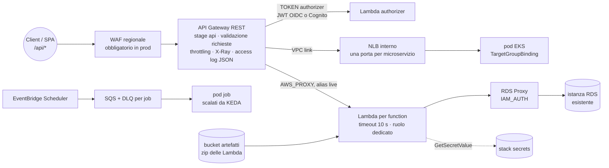

# Pattern `backend`

Comando: `/kynfra:create-backend-infra-aws` · modulo `modules/backend` · stack `envs/<env>/backend` per ambiente più lo stack condiviso `envs/shared/apigw-account` · richiede `network` e `secrets` (con microservizi o job anche `eks` ed `ecr`) · stato `<progetto>/<env>/backend.tfstate`.

Non è uno scheletro: il comando **legge il progetto kybes** (sezione `kybes` in `.kynfra/config.json`, obbligatoria: la config la scrive l'utente o l'installer in un repository kybes) e genera l'infrastruttura completa di ogni elemento.

## Cosa genera da kybes

| Sorgente kybes | Infrastruttura generata |
|---|---|
| `schemas/openapi.yaml` | API Gateway REST: Terraform legge il file (`yamldecode(file(...))`) a ogni plan, aggiunge a ogni operazione integrazione, validatore e authorizer e lo passa come `body`. **Lo schema resta l'unica fonte**: un endpoint nuovo appare al plan successivo |
| `services/<contesto>/functions/<nome>` | Lambda (runtime e handler dal manifest: `package.json` con `engines.node` e `main`, o `pyproject.toml` con `requires-python` e `handler.py`/`app.py`), ruolo IAM, log group cifrato con retention, X-Ray, alias `live`, permesso di invocazione limitato allo stage, accesso ai segreti del contesto e a RDS Proxy |
| `services/<contesto>/ms/<nome>` | integrazione VPC link verso un NLB interno condiviso, una porta e un target group IP per microservizio (porte `10001`, `10002`, … in ordine alfabetico, o `ms_listener_ports`), ruolo Pod Identity per il service account `<contesto>-<nome>`, repository ECR nello stack condiviso |
| `jobs/<nome>` | coda SQS cifrata con DLQ (`maxReceiveCount` 5), schedule EventBridge Scheduler se `jobs/<nome>/job.yaml` ha `schedule: "cron(...)"` o `rate(...)`, ruolo Pod Identity che consuma la coda, repository ECR |
| `schemas/db` presente | RDS Proxy con TLS e **autenticazione IAM end-to-end** (`IAM_AUTH`, nessun segreto) davanti a un'istanza esistente, security group raggiungibile solo dalle Lambda |

**Mappatura endpoint → handler.** Ogni operazione indica il suo handler con l'estensione `x-kybes-handler: <contesto>/functions/<nome>` (o `<contesto>/ms/<nome>`). Se manca vale la convenzione `/v1/<contesto>/…` (il prefisso di versione è facoltativo) quando il contesto ha un solo handler; le operazioni ambigue vanno confermate dall'utente, e kynfra **non inventa mai un handler**. La mappatura vive in `envs/<env>/backend/handlers.auto.tfvars`, `jobs.auto.tfvars` e `kybes.auto.tfvars`: file **generati, rigenerati a ogni comando, mai da modificare a mano**. La regola `api-coverage` (block) li confronta con il progetto a ogni stop gate e in CI: un'operazione senza handler, un handler senza infrastruttura o un residuo bloccano finché non si rigenera.

## Dettagli di API Gateway

- **Stage `api`** con percorso base da `servers[0].url` dello schema (es. `/v1`): l'URL diretto è `https://<id>.execute-api.<regione>.amazonaws.com/api/v1/…` e il comportamento `/api/*` della SPA inoltra `/api/v1/…` senza riscritture (`api_origin_path` vuoto).
- **Authorizer**: API Gateway REST non ha un authorizer JWT nativo. `authorizer = lambda` (default) è un authorizer `TOKEN` su una Lambda che valida il JWT OIDC (`oidc_issuer`, `oidc_audience`; il codice è `authorizer/authorizer.zip` nel bucket degli artefatti, fuori dal kit); `authorizer = cognito` è `COGNITO_USER_POOLS` sulla `cognito_user_pool_arn`. Si applica a ogni operazione tranne quelle con `security: []` nello schema **e** elencate in `public_routes` della config (due chiavi: lo schema da solo non basta).
- Validazione delle richieste (corpo e parametri), throttling (`throttling_rate_limit`, `throttling_burst_limit`), metriche, log `INFO`, access log JSON con `correlationId = $context.requestId` su log group cifrato, X-Ray, WAF regionale con managed rule set e limite per IP.
- **Pacchetti Lambda**: zip caricati dalla build nel bucket degli artefatti (privato, versionato, SSE-KMS); Terraform riferisce chiave e hash (`artifact_keys`, `artifact_sha256s`), non costruisce il codice. Nessun segreto nelle variabili d'ambiente.

## Input

| Input | Tipo | Default | Significato |
|---|---|---|---|
| `authorizer` | string | `lambda` | `lambda` (TOKEN su Lambda, JWT OIDC) o `cognito` |
| `cognito_user_pool_arn` | string | vuoto | con `authorizer=cognito`: ARN della user pool |
| `oidc_issuer` | string | vuoto | con `lambda`: issuer (claim `iss`); vuoto = dedotto da `openIdConnectUrl` dello schema |
| `oidc_audience` | string | vuoto | con `lambda`: **obbligatoria**, audience attesa (claim `aud`) |
| `log_retention_days` | number | `90` | retention di log Lambda, API Gateway, WAF (almeno 365 in prod) |
| `throttling_rate_limit` / `throttling_burst_limit` | number | `100` / `200` | richieste al secondo di regime e di picco sullo stage |
| `waf_enabled` | bool | `false` | WAF regionale (sempre attivo in prod) |
| `deletion_protection` | bool | `false` | deletion protection dell'NLB interno (sempre attiva in prod) |
| `kubernetes_namespace` | string | `default` | namespace dei service account di microservizi e job |
| `db_instance_identifier` | string | vuoto | con `schemas/db`: istanza RDS esistente dietro il proxy |
| `db_engine_family` | string | `POSTGRESQL` | `POSTGRESQL` o `MYSQL` (anche MariaDB); `IAM_AUTH` non supporta SQL Server |

## Output e cablaggio tra stack

- Output: `api_id`, `stage_name`, `api_domain_name` (letto dalla SPA), `api_origin_path`, `base_path`, `invoke_url`, `lambda_function_names`, `lambda_role_arns`, `artifacts_bucket`, `artifact_keys`, `kms_key_arn`, `queue_urls`, `queue_arns`, `dlq_urls`, `pod_role_arns`, `service_accounts`, `vpc_link_id`, `ms_target_group_arns`, `ms_listener_ports`, `ms_nlb_security_group_id`, `db_proxy_endpoint`, `db_proxy_security_group_id`.
- **Legge** `network` (VPC e subnet private), `secrets` (`secret_arns`, `kms_key_arn`; lettura in un solo verso, lo stack secrets non legge mai il backend) e, con microservizi o job, `kubernetes` (`cluster_name`, `node_security_group_id`) ed `envs/shared/ecr` (`repository_urls`).
- Lo legge lo stack `spa` con `api_origin=backend`.

## Passi manuali

1. **Una sola volta per account e regione**, prima di ogni stack backend (salta il passo se un altro progetto dello stesso account l'ha già applicato): `cd <infra_root>/envs/shared/apigw-account && terraform init && terraform plan -out=apigw-account.tfplan && terraform apply apigw-account.tfplan`. Imposta il ruolo CloudWatch di API Gateway, senza il quale gli stage con access log non si creano.
2. Prima gli stack `network` e `secrets` dello stesso ambiente e, con microservizi o job, `kubernetes`, `kubernetes-addons` ed `envs/shared/ecr`; poi, per ogni ambiente, `envs/<env>/backend`.
3. La CI carica gli zip nel bucket `artifacts_bucket` (chiavi `<contesto>/<nome>.zip` e `authorizer/authorizer.zip`) con `kms:GenerateDataKey` sulla chiave `kms_key_arn` e passa `artifact_sha256s` (SHA-256 in base64 di ogni zip): **gli zip devono esistere prima del primo `apply`**.
4. Dopo ogni modifica di `services/`, `jobs/` o di `x-kybes-handler`, rigenera con `/kynfra:create-backend-infra-aws`.
5. Microservizi: registra i pod nel target group `ms_target_group_arns` con un `TargetGroupBinding` (targetType `ip`, porta 8080) e usa i service account di `service_accounts`. Job: leggono la propria coda (`queue_urls`) con il ruolo Pod Identity; KEDA scala con il ruolo dell'operatore (`identityOwner: operator`).
6. Database: crea l'utente IAM nel database (PostgreSQL `GRANT rds_iam`; MySQL/MariaDB `IDENTIFIED WITH AWSAuthenticationPlugin AS 'RDS'`), attiva `iam_database_authentication_enabled` sull'istanza e ammetti il security group del proxy nel security group del database. L'istanza è fuori dalla v1.

## Differenze in prod

| | dev / staging | prod |
|---|---|---|
| `log_retention_days` | 90 | 365 |
| `waf_enabled` | opzionale | **attivo** |
| `deletion_protection` (NLB interno) | opzionale | **attiva** |

Voci di baseline motivate: nessuna cache di stage (`CKV_AWS_120`, `CKV_AWS_225`: dati per utente dietro authorizer), nessuna concorrenza riservata né firma del codice (`CKV_AWS_115`, `CKV_AWS_272`: scelte della pipeline), nessuna DLQ sulle Lambda sincrone (`CKV_AWS_116`).
