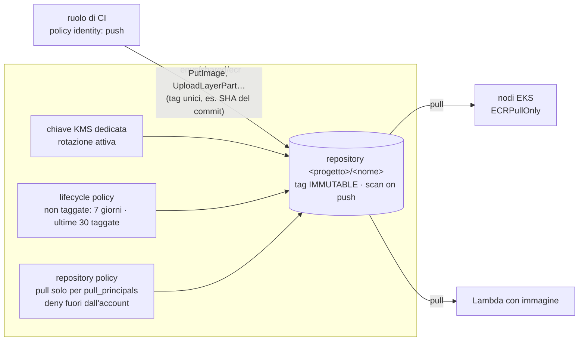

# Pattern `ecr`

Comando: `/kynfra:create-ecr-infra-aws` · modulo `modules/ecr` · stack **condiviso** `envs/shared/ecr` (si genera una sola volta, senza `--env`) · nessun `requires` · stato `<progetto>/shared/ecr.tfstate`.

Un registry privato di container condiviso tra gli ambienti: le immagini sono costruite una volta e promosse, non ricostruite per ambiente.

## Cosa crea

- Chiave KMS dedicata con rotazione attiva e alias `<progetto>-<env>-ecr`; policy della chiave con amministrazione alla radice dell'account.
- Un `aws_ecr_repository` per nome in `repositories`, chiamato `<progetto>/<nome>`: tag `IMMUTABLE`, scansione al push, cifratura con la chiave dedicata, `force_delete = false`.
- `aws_ecr_lifecycle_policy` per repository: le immagini non taggate scadono dopo `untagged_expiry_days`; restano le ultime `keep_last` taggate.
- `aws_ecr_repository_policy` per repository: pull (`GetDownloadUrlForLayer`, `BatchGetImage`, `BatchCheckLayerAvailability`) solo per i ruoli di `pull_principals` (stesso account; vuoto = nessuna concessione), più un **deny** per i principal fuori dall'account (servizi AWS esclusi, così replica e scansione non si rompono). Nessun accesso pubblico.
- Il **push non è concesso dalla repository policy**: i ruoli di CI hanno una policy identity con `ecr:GetAuthorizationToken` su `*` e, sull'ARN del repository, `ecr:PutImage`, `ecr:InitiateLayerUpload`, `ecr:UploadLayerPart`, `ecr:CompleteLayerUpload`, `ecr:BatchCheckLayerAvailability`. I tag sono immutabili: usa tag unici.

## Input

| Input | Tipo | Default | Significato |
|---|---|---|---|
| `repositories` | string, **richiesto** | | nomi dei repository separati da virgola, in kebab-case (`api,worker`); in un repository kybes uno per `services/*/ms/*` e `jobs/*` |
| `pull_principals` | string | vuoto | ARN di ruoli IAM dell'account autorizzati al pull, separati da virgola |
| `untagged_expiry_days` | number | `7` | giorni dopo i quali scadono le immagini non taggate |
| `keep_last` | number | `30` | immagini taggate più recenti da conservare per repository |

## Output e cablaggio tra stack

- Output: `repository_urls` (nome => URL), `repository_arns`, `kms_key_arn`, `registry_id` (ID dell'account).
- **Lettura in un solo verso**: lo stack `ecr` non legge mai lo stato di altri stack. I workload (EKS, Lambda, backend) leggono `repository_urls` e `repository_arns` con `terraform_remote_state` (chiave `<progetto>/shared/ecr.tfstate`).
- Nel backend kybes i repository sono nominati `<contesto>-<nome>` per i microservizi e `<nome>` per i job.

## Passi manuali

1. Il DevOps, con le credenziali dell'account: `cd <infra_root>/envs/shared/ecr && terraform init && terraform plan -out=ecr.tfplan && terraform apply ecr.tfplan`.
2. Dai ai ruoli di CI la policy identity di push (sopra).
3. `pull_principals` è facoltativo: aggiungi più tardi gli ARN dei ruoli dei nodi EKS o delle Lambda se vuoi una concessione anche nella resource policy.

## Differenze tra ambienti

Nessuna: lo stack è condiviso e unico per l'account. La protezione non cambia con l'ambiente; per questo il pattern non ha `env_defaults`.
