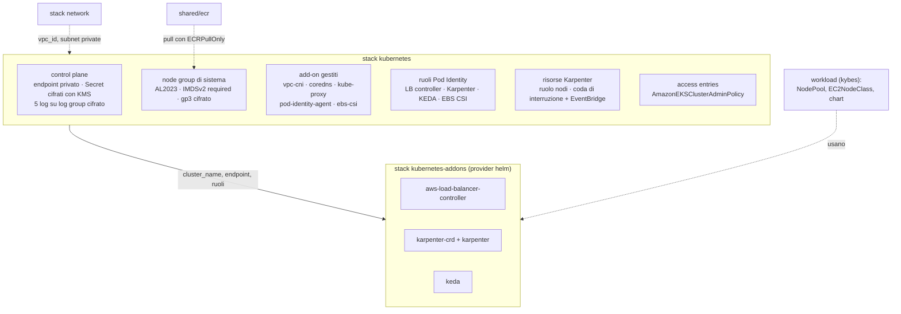

# Pattern `eks`

Comando: `/kynfra:create-eks-infra-aws` · moduli `modules/eks` e `modules/eks/addons` · stack `envs/<env>/kubernetes` e `envs/<env>/kubernetes-addons` per ambiente · richiede `network` ed `ecr` · stati `<progetto>/<env>/kubernetes.tfstate` e `kubernetes-addons.tfstate`.

Un cluster EKS per i workload kybes (microservizi e job), nelle subnet private dello stack `network`. I manifest e i chart applicativi sono compito di kybes: kynfra installa solo i componenti di sistema.

## Cosa crea

| Area | Dettaglio |
|---|---|
| Control plane | cluster `<progetto>-<env>` alla `kubernetes_version` (default `1.36`: l'ultima supportata sia da EKS sia dai chart bloccati, KEDA 2.21 arriva a 1.36); `endpoint_private_access = true`, endpoint pubblico solo con `public_endpoint_cidrs` non vuoto (`0.0.0.0/0` e `::/0` rifiutati); deletion protection (obbligatoria in prod); ogni add-on è un add-on gestito |
| Cifratura | Secret Kubernetes con chiave KMS dedicata; log del control plane con chiave KMS; volumi dei nodi con chiave EBS; rotazione attiva su tutte |
| Log | log group `/aws/eks/<cluster>/cluster` creato prima del cluster, con `log_retention_days` e KMS; tutti e cinque i tipi di log |
| Accesso | `authentication_mode = "API"`, nessun `aws-auth`, nessun amministratore implicito (`bootstrap_cluster_creator_admin_permissions = false`); ogni ARN di `admin_principals` (stesso account, controllato in plan) ha una access entry con `AmazonEKSClusterAdminPolicy`; i nodi Karpenter entrano con una access entry `EC2_LINUX` |
| Nodi di sistema | node group gestito nelle subnet private, AL2023, on-demand, launch template con `http_tokens = "required"` e hop limit 1 (i pod non raggiungono le credenziali del nodo), disco gp3 cifrato, security group dedicato `node_security_group_id` senza regole; ruolo con `AmazonEKSWorkerNodePolicy`, `AmazonEKS_CNI_Policy`, `AmazonEC2ContainerRegistryPullOnly` |
| Add-on gestiti | `vpc-cni`, `kube-proxy`, `eks-pod-identity-agent`, poi `coredns` e `aws-ebs-csi-driver`; versione più recente compatibile col cluster (o quella fissata in `addon_versions`): una nuova build appare nel plan come update in-place |
| Pod Identity | un ruolo per componente, con trust `pods.eks.amazonaws.com` limitato a cluster, namespace e service account: `kube-system/aws-load-balancer-controller`, `kube-system/karpenter`, `keda/keda-operator` (`sqs:GetQueueAttributes` sulle code `<progetto>-<env>-*`), `kube-system/ebs-csi-controller-sa`. **Niente OIDC provider** (niente IRSA) |
| Karpenter | ruolo dei nodi `<progetto>-<env>-karpenter-node`, coda di interruzione SQS e regole EventBridge (Spot, rebalance, stato istanze, Health) |
| Helm (`kubernetes-addons`) | AWS Load Balancer Controller, Karpenter (con il chart delle CRD, `skip_crds` sul controller) e KEDA, con versioni dei chart **bloccate** da `versions.json` e autenticazione con il token di breve durata di `aws_eks_cluster_auth` |

## Input

| Input | Tipo | Default | Significato |
|---|---|---|---|
| `kubernetes_version` | string | `1.36` | versione minore di Kubernetes |
| `public_endpoint_cidrs` | string | vuoto | CIDR ammessi sull'endpoint pubblico, separati da virgola; vuoto = solo privato |
| `admin_principals` | string, **richiesto** | | ARN di ruoli o utenti IAM amministratori (access entries), separati da virgola; **deve includere l'identità che applica `kubernetes-addons`** |
| `node_instance_types` | string | `m6i.large,m5.large` | tipi di istanza x86_64 del node group di sistema |
| `node_min_size` / `node_max_size` / `node_desired_size` | number | `2` / `4` / `2` | dimensione del node group di sistema |
| `log_retention_days` | number | `90` | retention dei log del control plane (almeno 365 in prod) |
| `deletion_protection` | bool | `false` | deletion protection del cluster (sempre attiva in prod) |

## Output e cablaggio tra stack

- Output del cluster: `cluster_name`, `cluster_arn`, `cluster_endpoint`, `cluster_ca`, `cluster_security_group_id`, `node_security_group_id`, `node_subnet_ids`, `node_kms_key_arn`, `karpenter_queue_name`, `karpenter_node_role_name`, `pod_role_arns`.
- **Legge** `network` (`vpc_id`, `private_subnet_ids`); `kubernetes-addons` legge lo stato di `kubernetes`. I nodi fanno il pull da `envs/shared/ecr` con `AmazonEC2ContainerRegistryPullOnly`; per una concessione anche nella repository policy aggiungi in `pull_principals` dello stack `ecr` i ruoli `<progetto>-<env>-eks-node` e `<progetto>-<env>-karpenter-node`.
- Lo legge lo stack `backend` (cluster e security group dei nodi) e l'NLB interno dei microservizi.

## Passi manuali

1. Prima `network` e `envs/shared/ecr`.
2. Per ogni ambiente: `cd <infra_root>/envs/<env>/kubernetes && terraform init && terraform plan -out=kubernetes.tfplan && terraform apply kubernetes.tfplan`.
3. Poi `kubernetes-addons`, con un'identità presente in `admin_principals` e una rete che raggiunge l'endpoint dell'API server (endpoint privato: VPN, Direct Connect o bastion nella VPC con la 443 ammessa nel security group `cluster_security_group_id`; oppure il proprio IP in `public_endpoint_cidrs`).
4. **Karpenter crea nodi solo con almeno un `NodePool` e un `EC2NodeClass`**: sono risorse dei workload (kybes), con `spec.role = karpenter_node_role_name`, subnet `node_subnet_ids`, security group `cluster_security_group_id` e `node_security_group_id`, IMDSv2 obbligatorio e dischi cifrati con `node_kms_key_arn`. Un esempio conforme è nel README del modulo `eks`; l'alias AMI va fissato a una release testata, mai `@latest` in prod.
5. I pod raggiungono AWS solo con EKS Pod Identity (`aws_eks_pod_identity_association` con ruolo `pods.eks.amazonaws.com`); gli scaler SQS di KEDA usano il ruolo dell'operatore (`identityOwner: operator`).
6. `destroy` in ordine inverso: prima i NodePool (Karpenter termina i suoi nodi), poi `kubernetes-addons`, poi `kubernetes`; in prod prima `deletion_protection = false` e un `apply`.

## Differenze in prod

| | dev / staging | prod |
|---|---|---|
| nodi di sistema (min / max / desiderati) | 2 / 4 / 2 | 3 / 6 / 3 |
| `log_retention_days` | 90 | 365 |
| `deletion_protection` | opzionale | **attiva** |

Costo fisso: il control plane EKS e i nodi di sistema. Voci di baseline motivate: retention a 90 giorni in dev (`CKV_AWS_338`), endpoint pubblico acceso solo con CIDR (`CKV_AWS_39`), versione di default in standard support (`CKV_AWS_339`) e le azioni della policy ufficiale dell'AWS Load Balancer Controller trascritta senza modifiche (`CKV_AWS_290`, `CKV_AWS_355`).
