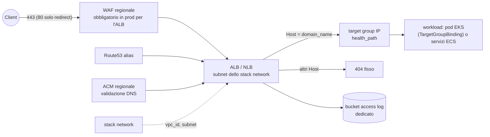

# Pattern `elb`

Comando: `/kynfra:create-elb-infra-aws` · modulo `modules/elb` · stack `envs/<env>/elb` (un ambiente per comando: `single_env`) e, con `hosted_zone=create`, `envs/shared/dns` (la stessa zona del pattern `spa`) · richiede `network` · stato `<progetto>/<env>/elb.tfstate`.

Un load balancer davanti ai workload: ALB (default) oppure NLB.

## Cosa crea

| Area | Dettaglio |
|---|---|
| Load balancer | `<progetto>-<env>-<type>` nelle subnet pubbliche (o private con `internal = true`); `drop_invalid_header_fields = true` e `desync_mitigation_mode = "strictest"` (ALB); cross-zone (NLB); deletion protection (obbligatoria in prod) |
| Listener | ALB: 443 HTTPS con `ELBSecurityPolicy-TLS13-1-2-2021-06`; pubblico: azione di default 404 e regola che inoltra solo `Host = domain_name` (richieste per IP o per nome `*.elb.amazonaws.com` ricevono 404); interno: inoltro di default; 80 solo redirect 301 a HTTPS. NLB: 443 TLS con la stessa policy, inoltro TCP, nessuna porta 80 |
| TLS e DNS | certificato ACM regionale per `domain_name` validato via DNS; alias Route53 A (e AAAA con dualstack) |
| Target | un target group di default `target_type = "ip"`, protocollo HTTP (ALB) o TCP (NLB) su `target_port`, health check HTTP su `health_path` (200-399) |
| Security group | `allow_from = internet`: 443 (e 80 per il redirect dell'ALB) dal mondo; `allow_from = cloudfront`: solo 443 dalla prefix list gestita `com.amazonaws.global.cloudfront.origin-facing` (occupa circa 55 voci della quota di 60 regole per security group); `internal`: dalla VPC. Egress solo verso la VPC sulla `target_port` |
| Access log | bucket privato dedicato (BucketOwnerEnforced, versioning, SSE-S3 come richiesto dall'ALB, scadenza 365 giorni, solo TLS), scrivibile solo dal servizio di log ELB |
| WAF | con `waf_enabled` (obbligatorio in prod per l'ALB, rifiutato per l'NLB): web ACL REGIONAL con managed rule set e limite per IP; log su log group cifrato |

## Input

| Input | Tipo | Default | Significato |
|---|---|---|---|
| `type` | string | `alb` | `alb` (HTTP/HTTPS) oppure `nlb` (TLS terminato sul load balancer, inoltro TCP, niente WAF) |
| `internal` | bool | `false` | `true`: interno nelle subnet private (client solo dalla VPC) |
| `allow_from` | string | `internet` | `internet` oppure `cloudfront` (solo per i pubblici) |
| `domain_name` | string, **richiesto** | | dominio del load balancer in questo ambiente |
| `hosted_zone` | string, **richiesto** | | `create` (zona in `envs/shared/dns`) oppure `existing:<zone_id>` |
| `zone_name` | string | vuoto | con `create` e zona non ancora generata: nome della zona |
| `target_port` | number | `8080` | porta dei target |
| `health_path` | string | `/healthz` | percorso dell'health check |
| `deletion_protection` | bool | `false` | sempre attiva in prod |
| `waf_enabled` | bool | `false` | WAF regionale (sempre attivo in prod per l'ALB; con `type=nlb` deve essere `false`) |

## Output e cablaggio tra stack

- Output: `lb_arn`, `lb_dns_name`, `lb_zone_id`, `https_listener_arn`, `target_group_arn`, `security_group_id`.
- **Legge** `network` (`vpc_id`, `public_subnet_ids`, `private_subnet_ids`, chiave `<progetto>/<env>/network.tfstate`) e, con `hosted_zone=create`, `envs/shared/dns`. Controlla in plan che la zona sia pubblica e contenga `domain_name`.
- I workload si registrano nel `target_group_arn` (target IP: `TargetGroupBinding` dell'AWS Load Balancer Controller su EKS, o `load_balancer` di un servizio ECS) e ammettono nel proprio security group la `target_port` dal `security_group_id` del load balancer.
- Più servizi sullo stesso ALB: aggiungi un `aws_lb_target_group` e un `aws_lb_listener_rule` sul listener HTTPS (condizione host o percorso, priorità diversa da 100); mai regole sul listener HTTP.

## Passi manuali

1. Prima lo stack `network` dello stesso ambiente e, con `hosted_zone=create`, la zona: `cd <infra_root>/envs/shared/dns && terraform init && terraform plan -out=dns.tfplan && terraform apply dns.tfplan`, delegando i `name_servers` dal registrar (altrimenti la validazione ACM non termina).
2. Per ogni ambiente: `cd <infra_root>/envs/<env>/elb && terraform init && terraform plan -out=elb.tfplan && terraform apply elb.tfplan`.
3. Con la deletion protection attiva (prod) il `destroy` richiede prima `deletion_protection = false` e un `apply`.
4. Se una distribuzione CloudFront sta davanti (`allow_from = cloudfront`), deve usare `domain_name` come origin e **non** inoltrare l'`Host` del viewer.

## Differenze in prod

| | dev / staging | prod |
|---|---|---|
| deletion protection | opzionale | **obbligatoria** (`enable_deletion_protection = var.deletion_protection`, controllo `prod_toggles`) |
| WAF sull'ALB | opzionale | **obbligatorio** |

Quota: 10 resource policy di CloudWatch Logs per regione e account, condivise con gli altri stack che loggano WAF o query DNS. Voci di baseline: `CKV_AWS_150` (la deletion protection di prod è imposta da validazione e `env_defaults`), `CKV_AWS_260` (porta 80 solo redirect), bucket dei log senza replica né log di accesso.
