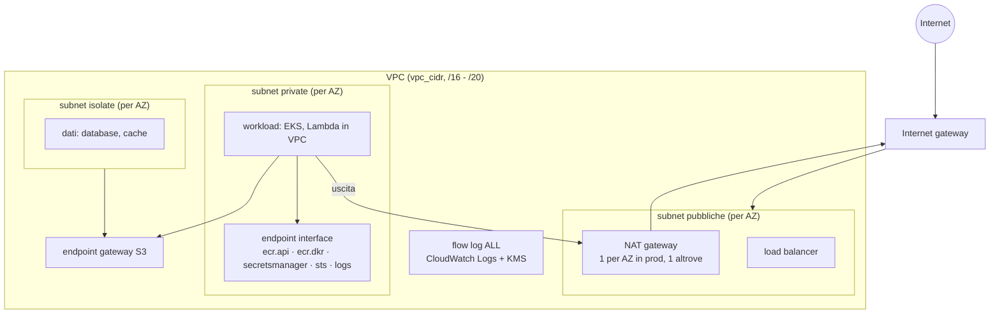

# Pattern `network`

Comando: `/kynfra:create-network-infra-aws` · modulo `modules/network` · stack `envs/<env>/network` (uno per ambiente) · stato `<progetto>/<env>/network.tfstate`.

Fondamenta di rete per ELB, EKS e backend: una VPC con tre livelli di subnet su 2 o 3 zone di disponibilità.

## Cosa crea

| Livello | Uscita | Uso |
|---|---|---|
| pubbliche | internet gateway | load balancer, NAT gateway |
| private | NAT gateway | workload (EKS, Lambda in VPC) |
| isolate | nessuna | dati (database, cache) |

- Subnet calcolate con `cidrsubnet` (prefisso della VPC + 4 bit, da /20 a /24). Le zone sono le prime `az_count` disponibili (`data aws_availability_zones`), oppure quelle fissate con l'input `availability_zones` del modulo.
- NAT: uno per zona con `nat_per_az = true` (prod), uno solo altrimenti.
- Endpoint VPC: gateway S3 (rotte private e isolate; la policy ammette solo i bucket dell'account e il bucket dei layer ECR); interface `ecr.api`, `ecr.dkr`, `secretsmanager`, `sts`, `logs` nelle subnet private, con un security group dedicato che accetta 443 solo dal CIDR della VPC.
- Flow log (`ALL`) su CloudWatch Logs, cifrati con una chiave KMS dedicata a rotazione attiva e con retention configurabile.
- Il security group di default non ha regole.

## Input

| Input | Tipo | Default | Significato |
|---|---|---|---|
| `vpc_cidr` | string | `10.0.0.0/16` | CIDR della VPC (da /16 a /20) |
| `az_count` | number | `2` | zone di disponibilità: 2 o 3 |
| `nat_per_az` | bool | `false` | un NAT gateway per zona (true) o uno solo (false) |
| `flow_log_retention_days` | number | `90` | retention in giorni dei flow log |

## Output e cablaggio tra stack

`vpc_id`, `public_subnet_ids`, `private_subnet_ids`, `isolated_subnet_ids`, `vpc_endpoint_sg_id`. Gli stack `elb`, `eks` e `backend` li leggono con `terraform_remote_state` (chiave `<progetto>/<env>/network.tfstate`); lo stack `network` non legge nessuno stato.

## Passi manuali

Il DevOps, con le credenziali dell'account, per ogni ambiente: `cd <infra_root>/envs/<env>/network && terraform init && terraform plan -out=network.tfplan && terraform apply network.tfplan`. Il bucket dello stato (`bootstrap/`) deve esistere prima dell'`init`.

## Differenze in prod

| | dev / staging | prod |
|---|---|---|
| zone di disponibilità | 2 | 3 |
| NAT gateway | uno solo | uno per zona |
| retention dei flow log | 90 giorni | 365 giorni (validazione del modulo: almeno 365) |

Costi fissi da conoscere: i NAT gateway (tre in prod) e gli endpoint interface (cinque per ogni zona). Voci di baseline motivate: `CKV_AWS_394` (zone scelte da `data`) e `CKV_AWS_338` (90 giorni in dev e staging).
