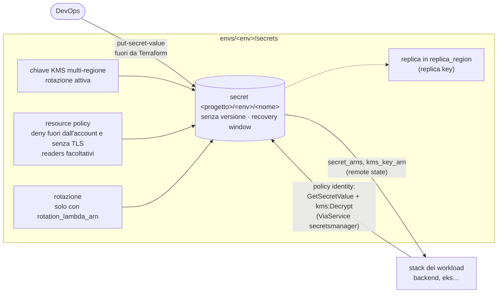

# Pattern `secrets`

Comando: `/kynfra:create-secrets-infra-aws` · modulo `modules/secrets` · stack `envs/<env>/secrets` per ambiente · nessun `requires` (si applica **per primo**) · stato `<progetto>/<env>/secrets.tfstate`.

Secrets Manager come *secret vault*: i segreti sono **contenitori senza valore**, cifrati con una chiave KMS dedicata. Il modello generale è in [segreti](../segreti.md).

## Cosa crea

- Chiave KMS **multi-regione** con rotazione attiva e alias `<progetto>-<env>-secrets`. La policy della chiave dà l'amministrazione alla radice dell'account (i ruoli dell'account la usano con una policy identity) e `Decrypt` ai `readers`, solo tramite Secrets Manager della regione (`kms:ViaService`).
- Un `aws_secretsmanager_secret` per voce della mappa `secrets`, chiamato `<progetto>/<env>/<nome>` (eccezione motivata alla regola dei prefissi `<progetto>-<env>-`: è la convenzione di Secrets Manager), con `recovery_window_in_days`.
- **Nessuna `aws_secretsmanager_secret_version`**: il valore lo inserisce il DevOps fuori da Terraform.
- Resource policy per segreto: deny per i principal fuori dall'account (servizi AWS esclusi) e per il traffico non TLS; `readers` aggiunge una concessione facoltativa a ruoli già esistenti.
- Rotazione (`aws_secretsmanager_secret_rotation`) solo per i segreti con `rotation_lambda_arn`, ogni `rotation_days` (in prod al massimo 30).
- Con `replica_region` (diversa dalla regione dello stack): replica della chiave (`aws_kms_replica_key`, provider con alias) usata dalla replica dei segreti. È la "chiave KMS dedicata" per regione, non una chiave condivisa.

## Input

| Input | Tipo | Default | Significato |
|---|---|---|---|
| `recovery_window_days` | number | `7` | giorni di recupero di un segreto cancellato (7-30; in prod 30) |
| `replica_region` | string | vuoto | regione di replica; vuoto = nessuna replica |

L'elenco dei segreti non è un input del comando: si modifica la mappa `secrets` in `envs/<env>/secrets/terraform.tfvars` (`nome => { description, readers, rotation_lambda_arn }`; `readers` e `rotation_lambda_arn` facoltativi). Il template contiene un segreto di esempio.

## Output e cablaggio tra stack

- Output: `secret_arns` (nome => ARN), `secret_names` (nome => nome completo), `kms_key_arn`.
- **Lettura in un solo verso**: lo stack `secrets` non legge mai lo stato degli altri. Gli stack dei workload (`backend`, ecc.) leggono `secret_arns` e `kms_key_arn` con `terraform_remote_state` (chiave `<progetto>/<env>/secrets.tfstate`) e danno al proprio ruolo una policy identity: `secretsmanager:GetSecretValue` sull'ARN del segreto e `kms:Decrypt` sulla chiave con `kms:ViaService = secretsmanager.<regione>.amazonaws.com`.
- `readers` non è esclusivo: nello stesso account anche le policy identity dei ruoli danno accesso.

## Passi manuali

1. Applica per primo lo stack: modifica la mappa `secrets` in `terraform.tfvars`, poi il DevOps, con le credenziali dell'account: `cd <infra_root>/envs/<env>/secrets && terraform init && terraform plan -out=secrets.tfplan && terraform apply secrets.tfplan`.
2. Inserisci i valori **fuori da Terraform**: `aws secretsmanager put-secret-value --secret-id <progetto>/<env>/<nome> --secret-string <valore>`. Mai nei file né da un agente (la shell dell'agente non può leggere né scrivere i valori).
3. Con `rotation_lambda_arn`, la Lambda (di un altro stack) richiede un ruolo con `DescribeSecret`, `GetSecretValue`, `PutSecretValue`, `UpdateSecretVersionStage` sul segreto (più `GetRandomPassword`), `kms:Decrypt` e `kms:GenerateDataKey` sulla chiave, e un `aws_lambda_permission` per `secretsmanager.amazonaws.com`.
4. `readers` si può aggiungere più tardi con gli ARN di ruoli già esistenti.

## Differenze in prod

| | dev / staging | prod |
|---|---|---|
| `recovery_window_days` | 7 | 30 |
| intervallo di rotazione (`rotation_days`, default 30) | da 1 a 365 giorni | al massimo 30 giorni |

Le regole che sorvegliano il pattern sono `secrets` (nessun valore letterale), `kms-rotation` e `iam-least-privilege`.
