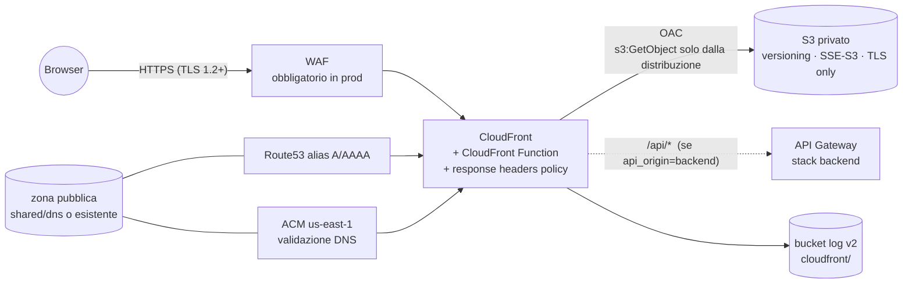

# Pattern `spa`

Comando: `/kynfra:create-spa-infra-aws` · modulo `modules/spa` · stack `envs/<env>/spa` (un ambiente per comando: `single_env`) e, con `hosted_zone=create`, lo stack condiviso `envs/shared/dns` · stato `<progetto>/<env>/spa.tfstate`.

Hosting di una single-page application: un bucket S3 **privato** servito solo da CloudFront.

## Cosa crea

| Area | Dettaglio |
|---|---|
| Contenuti | bucket `<progetto>-<env>-site-<account>`: BucketOwnerEnforced, public access block, versioning, SSE-S3, lifecycle sulle versioni non correnti, log di accesso, policy solo TLS; `s3:GetObject` e `s3:ListBucket` solo per `cloudfront.amazonaws.com` con `AWS:SourceArn` = la distribuzione (**OAC**, mai OAI o endpoint website), così gli oggetti mancanti rispondono 404 e non 403 |
| TLS | certificato ACM in `us-east-1` validato con record DNS nella zona; `sni-only`, `TLSv1.2_2021`; HTTP reindirizzato a HTTPS |
| DNS | record alias A e AAAA per `domain_name` |
| Routing | CloudFront Function (viewer-request) che riscrive i percorsi senza estensione in `/index.html`, `/api/*` escluso. **Nessun** `custom_error_response` che mappi 403/404 su `index.html`: gli errori reali, API comprese, restano visibili. Limite: un percorso il cui ultimo segmento contiene un punto (`/users/john.doe`) è trattato come file e risponde 404 |
| Header | response headers policy: HSTS (2 anni, includeSubDomains, preload), CSP restrittiva di default, `X-Content-Type-Options`, `X-Frame-Options: DENY`, `Referrer-Policy`, `Permissions-Policy` |
| Cache | il comportamento di default rispetta il `Cache-Control` dell'oggetto (TTL 0); `/index.html` mai in cache; `/assets/*` e `/_app/immutable/*` con CachingOptimized |
| Log | log standard di CloudFront v2 verso un bucket privato dedicato (`cloudfront/`, scadenza 365 giorni) |
| WAF | con `waf_enabled` (obbligatorio in prod): web ACL CLOUDFRONT con managed rule set (Common, KnownBadInputs, IP reputation) e limite per IP; log su log group cifrato (365 giorni) |
| API | con `api_origin=backend`: secondo origin HTTPS verso l'API Gateway e comportamento `/api/*` senza cache, stesso dominio |

## Input

| Input | Tipo | Default | Significato |
|---|---|---|---|
| `domain_name` | string, **richiesto** | | dominio pubblico della SPA in questo ambiente (`app.example.com` in prod, `dev.app.example.com` in dev) |
| `hosted_zone` | string, **richiesto** | | `create` (zona nuova in `envs/shared/dns`, nome = `domain_name` o `zone_name`) oppure `existing:<zone_id>` |
| `zone_name` | string | vuoto | con `create`: nome della zona, di solito il dominio radice; vuoto = `domain_name` del primo comando |
| `api_origin` | string | vuoto | `backend` per servire `/api/*` dall'API Gateway dello stack backend; vuoto = nessuna API |
| `waf_enabled` | bool | `false` | WAF davanti a CloudFront (sempre attivo in prod) |

Il comando chiede l'ambiente da generare: un comando per ambiente, ognuno con il suo dominio.

## Output e cablaggio tra stack

- Output della SPA: `bucket_name`, `distribution_id`, `distribution_domain_name` (li usa il deploy del frontend). Output dello stack `dns`: `zone_id`, `zone_name`, `name_servers`.
- **Legge** `envs/shared/dns` (con `hosted_zone=create`) e, con `api_origin=backend`, lo stack `backend` dello stesso ambiente (`api_domain_name`, `api_origin_path`, chiave `<progetto>/<env>/backend.tfstate`). Controlla in fase di plan che la zona sia pubblica e che `domain_name` sia la zona o un suo sottodominio.
- Con `api_origin=backend` lo stage dell'API si chiama `api` e `/api/v1/…` arriva alla risorsa `/v1/…` senza riscritture (`api_origin_path` vuoto).

## Passi manuali

1. Con `hosted_zone=create`, **prima la zona**: `cd <infra_root>/envs/shared/dns && terraform init && terraform plan -out=dns.tfplan && terraform apply dns.tfplan`. Poi **delega i `name_servers`** (output `zone_name` e `name_servers`) dal registrar o dalla zona padre: senza delega la validazione ACM non termina.
2. Per ogni ambiente: `cd <infra_root>/envs/<env>/spa && terraform init && terraform plan -out=spa.tfplan && terraform apply spa.tfplan`.
3. Con `api_origin=backend`, applica prima lo stack `backend` dello stesso ambiente.
4. Deploy del frontend: carica la build in `bucket_name` con `Cache-Control: public, max-age=31536000, immutable` sugli asset con hash e `no-cache` su `index.html`, poi invalida `/index.html` sulla distribuzione `distribution_id`. Il ruolo di deploy ha bisogno solo di `s3:PutObject`/`s3:DeleteObject`/`s3:ListBucket` sul bucket e `cloudfront:CreateInvalidation` sulla distribuzione.

## Differenze in prod

| | dev / staging | prod |
|---|---|---|
| WAF | opzionale (`waf_enabled`) | **obbligatorio** (`env_defaults` e regola `cloudfront-https`) |

Voci di baseline dello scanner per questo pattern (ciascuna con motivo in `scanner-baseline.json`): log di accesso CloudFront v2 invece del legacy che non consegna in `eu-south-1` (`CKV_AWS_86`), SSE-S3 sui bucket del sito e dei log (`CKV_AWS_145`), nessun failover dell'origin (`CKV_AWS_310`), nessuna geo restriction di default (`CKV_AWS_374`), WAF collegato solo con `waf_enabled` (`CKV2_AWS_47`), niente replica cross-region né notifiche sui bucket (`CKV_AWS_144`, `CKV2_AWS_62`) e niente DNSSEC sulla zona condivisa (`CKV2_AWS_38`: la chiave asimmetrica non ammette la rotazione automatica).
