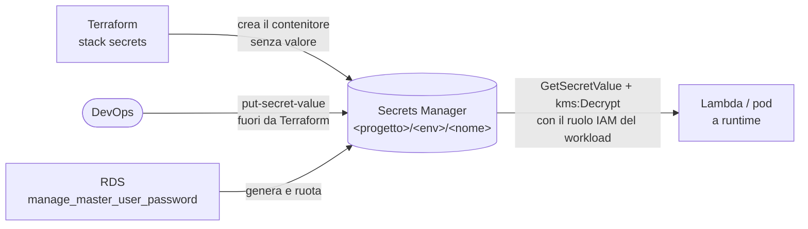

# Segreti

**Nessun valore di segreto compare mai nei file, nelle variabili, nei `tfvars`, nei comandi, nella conversazione con l'agente o nello stato di Terraform.** È un anti-obiettivo: una generazione che "funziona" ma lascia un segreto in chiaro è un fallimento.

## Il modello

- I segreti si creano come **contenitori** (`aws_secretsmanager_secret`, pattern [`secrets`](pattern/secrets.md)) cifrati con una chiave KMS dedicata, **senza** `aws_secretsmanager_secret_version`.
- Il valore lo inserisce il DevOps **fuori da Terraform** (`aws secretsmanager put-secret-value --secret-id <progetto>/<env>/<nome> --secret-string <valore>`), oppure lo genera AWS (`manage_master_user_password` per RDS, rotazione con Lambda). Mai da un agente: la shell rifiuta `get-secret-value` e `get-parameter* --with-decryption`, e la skill non ne chiede il valore.
- Dove un valore deve proprio passare da Terraform si usano **argomenti write-only** (`*_wo`, non salvati nello stato) se il provider li supporta, alimentati da `var.*` con `sensitive = true`.
- Le app leggono i segreti a **runtime** con il proprio ruolo IAM: policy identity con `secretsmanager:GetSecretValue` sull'ARN del segreto e `kms:Decrypt` sulla chiave con `kms:ViaService = secretsmanager.<regione>.amazonaws.com`. Le Lambda non hanno segreti nelle variabili d'ambiente, solo ARN, endpoint e nomi utente.
- Backend con RDS Proxy: l'autenticazione è IAM end-to-end (`IAM_AUTH`, token temporanei): nessuna password da conservare.

## Cosa fanno le regole

| Regola | Effetto |
|---|---|
| `secrets` | rifiuta segreti riconoscibili (chiavi AWS `AKIA…`, chiavi private PEM, token GitHub/Slack, `password = "…"`, connection string con credenziali) in `.tf`, `.tfvars`, `native/`; rifiuta `secret_string`/`secret_binary` con un letterale (qualunque letterale, anche corto o segnaposto: finirebbe nello stato); le variabili con nome riservato (`password`, `secret`, `token`, `api_key`, …) devono avere `sensitive = true` e nessun default |
| `static-credentials` | niente `access_key`/`secret_key`/token nel provider |
| `lambda-hardening` | variabili d'ambiente con nome sensibile e valore letterale |
| `native-params` | parametri riservati dei template nativi senza default e con `NoEcho`/`@secure()` |
| bash_guard | blocca la lettura dei valori (`get-secret-value`, `ssm get-parameter --with-decryption`) e le scritture dei file `.env*` |

I valori che rimandano a un segreto senza contenerlo sono ammessi: riferimenti a risorse (`aws_secretsmanager_secret.x.arn`), `var.*`, interpolazioni, `{{resolve:secretsmanager:…}}` nei template nativi, segnaposto riconoscibili (`<…>`, `changeme`).

## Cosa resta manuale

Inserire il valore di ogni segreto dopo l'`apply`; aggiungere una Lambda di rotazione (`rotation_lambda_arn`) se serve la rotazione automatica; concedere ai ruoli dei workload la lettura (policy identity nel loro stack). I passi esatti compaiono nel report di `/kynfra:create-secrets-infra-aws`.
