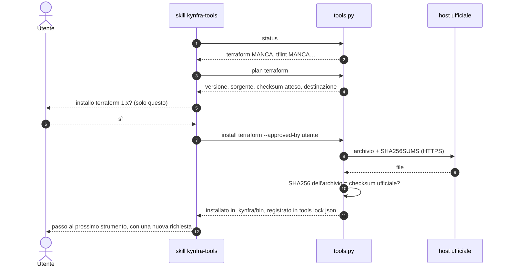

# Strumenti esterni: `tools.py`

Lo stop gate e la CI usano Terraform (o OpenTofu), TFLint con il suo ruleset AWS e uno scanner (Checkov o Trivy). kynfra può scaricarli, ma **solo con l'approvazione esplicita dell'utente, uno strumento alla volta**, e con traccia di ogni installazione. Nell'agente la shell rifiuta ogni altro modo di installarli (`curl … | sh`, `brew install`, `pip install`, `npm i -g`…).

## Comandi

```bash
python3 -B tools/kynfra/plugins/kynfra/scripts/tools.py status
python3 -B tools/kynfra/plugins/kynfra/scripts/tools.py plan terraform
python3 -B tools/kynfra/plugins/kynfra/scripts/tools.py install terraform --approved-by "Mario Rossi"
python3 -B tools/kynfra/plugins/kynfra/scripts/tools.py verify
```

| Comando | Cosa fa |
|---|---|
| `status` | per ogni strumento: richiesto o opzionale, versione attesa, versione trovata, presenza nel registro, esito (`ok`, `MANCA`, `NON CONFORME`) |
| `plan <tool>` | mostra nome, versione, sorgente ufficiale, checksum atteso e cartella di destinazione: il testo da sottoporre all'utente prima di installare |
| `install <tool> --approved-by "<utente>"` | scarica, verifica, installa e registra **un** strumento. `--approved-by` è obbligatorio (utente git che approva) |
| `verify` | controlla che i binari installati corrispondano al registro (checksum del binario e versione) |

Gli strumenti sono `terraform`, `opentofu` (alias `tofu`), `tflint`, `tflint-ruleset-aws`, `trivy` e `checkov`. `status` considera richiesti lo strumento IaC e lo scanner scelti in config, TFLint e il suo ruleset. Dentro l'agente si usa la skill `kynfra-tools` (`/kynfra:kynfra-tools`): mostra lo stato, propone **un** strumento, attende il sì dell'utente per quello strumento, lo installa, poi passa al successivo. Non esistono approvazioni cumulative né "sì a tutto": una risposta vale per uno strumento e una versione. `tools.py install` passa dalla richiesta di permesso del comando shell, quindi l'utente lo autorizza ogni volta.



## Sorgenti e verifica

Le versioni stanno in `plugins/kynfra/templates/versions.json` e le sorgenti in `tools-catalog.json`: sono l'unico punto in cui cambiano (le leggono anche `generate.py` e l'installer).

| Strumento | Sorgente |
|---|---|
| Terraform | `releases.hashicorp.com` (zip + `SHA256SUMS`) |
| OpenTofu, TFLint, ruleset AWS di TFLint, Trivy | GitHub releases del progetto (archivio + file dei checksum) |
| Checkov | PyPI, in un virtualenv dedicato |

- **Solo HTTPS e solo host ufficiali**: `releases.hashicorp.com`, `github.com`, `objects.githubusercontent.com`, `release-assets.githubusercontent.com` (CDN degli asset di GitHub), `pypi.org`, `files.pythonhosted.org`. L'host è controllato anche dopo ogni redirect.
- **Checksum SHA256**: l'archivio scaricato è confrontato con il file dei checksum ufficiale, scaricato via HTTPS dallo stesso host. Se non corrisponde, o se l'archivio non è nel file, l'installazione si annulla e non viene scritto nulla.
- **Le firme GPG non sono verificate nella v1** (solo libreria standard): la fiducia poggia su HTTPS, host ufficiale e checksum. Un host di rilascio compromesso che servisse archivio e checksum coerenti non verrebbe riconosciuto. Il catalogo lo dichiara per ogni strumento (`signature`).
- Versioni fissate a quella verificata, evitando le release pubblicate lo stesso giorno della verifica (Checkov è fissato a 3.3.29 per questo motivo).

### Checkov: pip isolato

Checkov è l'unico strumento Python e il rischio principale è l'esecuzione di codice di installazione. `tools.py` lo mitiga così:

- virtualenv dedicato in `.kynfra/venv` (mai l'ambiente globale);
- `pip` con ambiente pulito (`--isolated`: nessuna configurazione dell'utente, nessuna variabile `PIP_*`), solo l'indice `https://pypi.org/simple/`, **solo wheel** (`--only-binary=:all:`, quindi nessun `setup.py` eseguito), nessun prompt;
- prima `pip download checkov==<versione> --no-deps` per calcolare lo SHA256 della wheel e registrarlo, poi installazione da quel file.

Limite dichiarato: le wheel delle **dipendenze** di Checkov non sono fissate una per una (arrivano dallo stesso indice); restano coperte dall'isolamento ma non dal checksum.

## Installazione e risoluzione

- Gli strumenti si installano **solo** sotto `.kynfra/bin/` (e `.kynfra/venv/` per Checkov, `.kynfra/tflint.d/plugins/…` per il ruleset di TFLint), mai globalmente, **mai come root** né con `sudo` (lo script lo rifiuta). La cartella è ignorata da git.
- Lo stop gate usa prima quei binari, poi quelli nel `PATH`; un binario sotto `.kynfra/` è eseguito solo se il suo SHA256 coincide con quello del registro (altrimenti si passa al `PATH`).

## Registro: `.kynfra/tools.lock.json`

Lo scrive solo `tools.py` (chiavi ordinate, indent 2, scrittura atomica) ed è versionato:

```json
{
  "tools": {
    "terraform": {
      "version": "1.16.6",
      "source": "https://releases.hashicorp.com/terraform/1.16.6/terraform_1.16.6_linux_amd64.zip",
      "sha256": "…",
      "binary_sha256": "…",
      "installed_at": "2026-10-21T09:30:00Z",
      "approved_by": "Mario Rossi"
    }
  }
}
```

Un registro illeggibile o malformato non viene sovrascritto: `install` si ferma e chiede di correggerlo o ripristinarlo da git. Lo stop gate e la CI verificano che i binari usati corrispondano al registro (`verify`).

## In CI

Il workflow installa le versioni del registro senza approvazioni interattive: `--approved-by ci`, uno step per strumento. Lo usano sia il workflow dei progetti (`kynfra-check.yml`) sia la CI del kit ([sviluppo](sviluppo.md)).
